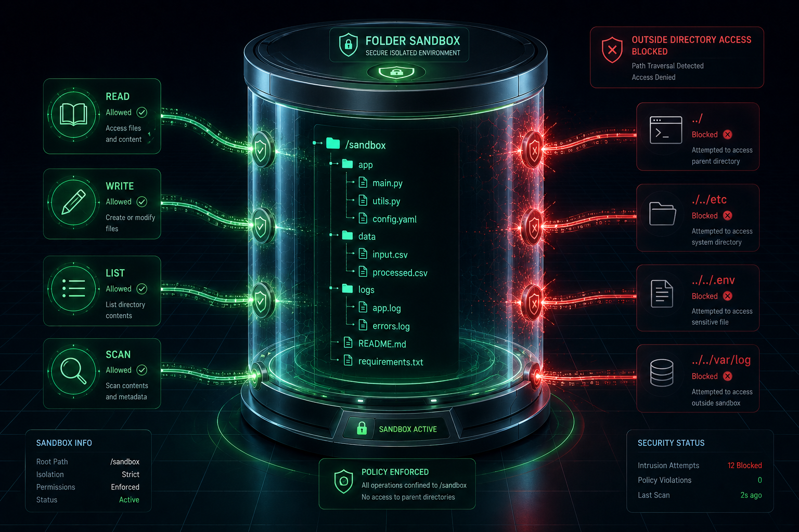
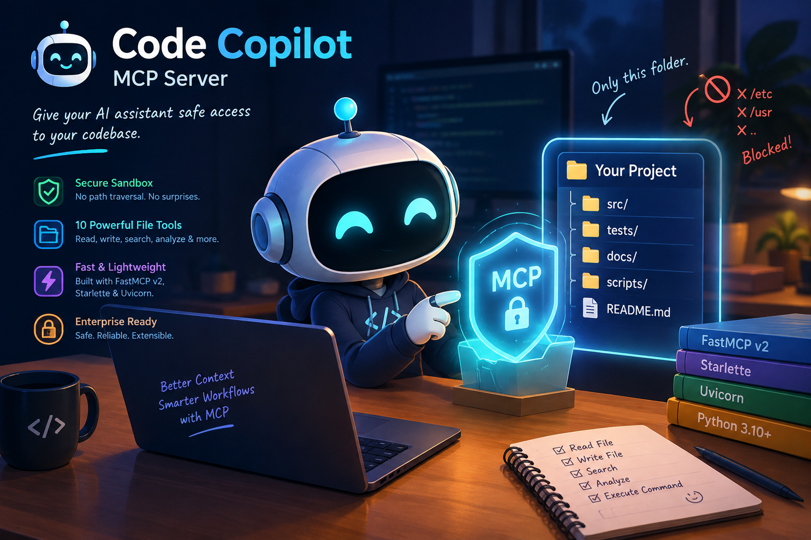
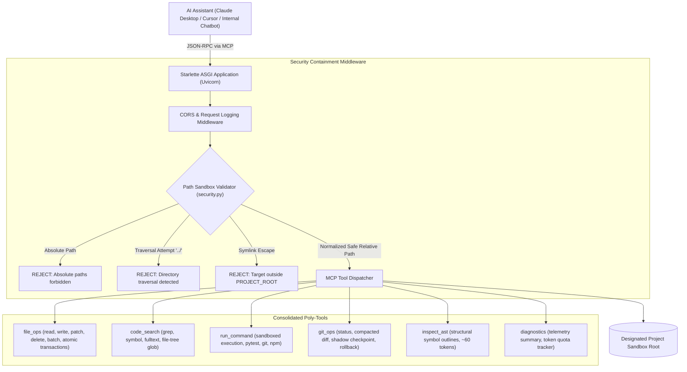

# 🤖 FastMCP Code Copilot
### Enterprise Sandboxed Model Context Protocol (MCP) Server for AI-Assisted Engineering

[](https://www.python.org/)
[](https://github.com/modelcontextprotocol/python-sdk)
[](https://www.starlette.io/)
[](https://www.uvicorn.org/)
[](https://opensource.org/licenses/MIT)
[](#)
[](https://www.linkedin.com/in/vignesh-manivasakam)

---

<p align="center">
  
  <br>
  <em>Filesystem isolation firewall confining agent operations to designated workspace while blocking directory traversal attacks (<code>../</code>, <code>/etc</code>, <code>.env</code>).</em>
</p>

---

## 📌 Executive Summary & Enterprise Origin

In strictly regulated enterprise R&D environments (such as Tier-1 automotive and industrial engineering), commercial cloud-based AI code assistants (like commercial GitHub Copilot) are frequently restricted due to proprietary IP leakage, strict network proxy constraints, and compliance mandates.

**FastMCP Code Copilot** was architected to bridge internal enterprise AI chatbots and desktop assistants (such as **Claude Desktop**, **Cursor**, or custom LLM gateways) directly to local codebases with institutional-grade cybersecurity rigor:
- **Zero Data Egress**: Operates entirely over local network transports (HTTP/SSE or standard I/O) without transmitting repository contents to unverified third parties.
- **Hardware-Level Containment**: Enforces strict directory containment, symlink escape checks, and path normalization.
- **High-Throughput Engineering Context**: Delivers 6 consolidated poly-tools cutting token overhead by **83%**, multi-file atomic transactions with automatic rollback, line-scoped reading, and AST symbol extraction.
- **Enterprise Web Interoperability**: Starlette ASGI dual-transport (`/mcp` and `/sse`) with CORS Private Network Access (`allow_private_network=True`) and FastMCP OriginGuard bypass for corporate HTTPS chatbots.
- **Zero-Clutter Reverse-Patch Undo**: Centralized SQLite reverse-patch undo in `.copilot/history.db` with **zero `.bak` files** created on disk.

---

## 📸 Architectural Showcase

| Security Sandbox & Path Containment | Developer Copilot & AST Codebase Tools |
| :---: | :---: |
|  |  |
| *Hardened containment firewall: eliminates directory escaping and path injection.* | *17 specialized code analysis tools: AST parsing, symbol extraction, and ripgrep.* |

---

## 🏗️ System Architecture & Security Model

The server operates as an asynchronous Starlette application exposing the standard **Model Context Protocol (MCP)** specification:



### Institutional Security Invariants:
1. **Root Boundary Enclosure**: Every operation is strictly relative to the designated `PROJECT_ROOT`. Attempting to access parent paths (`../../`) raises an immediate validation exception.
2. **Symlink Traversal Protection**: Evaluates `Path.resolve()` against the physical filesystem. If a symlink resolves to an inode outside the project root, access is terminated immediately.
3. **Internal State Concealment**: Persistent search indexes (`.mcp_index`) and telemetry databases (`.copilot/`) are excluded from file listings and search queries.
4. **Controlled Execution Whitelist**: Command execution is restricted to safe, verified developer toolchains (`pytest`, `git`, `python`, `npm`, `cargo`, `go`) with Windows `.cmd` resolution and process-tree termination.

---

## 🛠️ Consolidated Poly-Tools Architecture (83% Token Savings)

Instead of 25+ fine-grained schemas that bloat system prompts, operations are consolidated into **6 high-performance poly-tools**:

### 1. `file_ops`
- **Actions**: `read`, `write`, `patch`, `delete`, `info`, `batch_read`, and `transaction`.
- **Features**: Sliced line reading, Windows CRLF line-ending preservation without double-newlines, atomic temp-file replacement, and multi-file atomic transactions with automatic rollback on error.

### 2. `code_search`
- **Modes**: `grep` (regex with context lines), `symbol` (functions/classes across languages), `fulltext` (SQLite FTS5 indexing with `<<<match>>>` snippets), and `files` (glob file tree).
- **Features**: Native Ripgrep integration with Python fallback and guaranteed `.git`, `.venv`, and `node_modules` ignore pruning.

### 3. `run_command`
- **Features**: Sandboxed execution of whitelisted CLIs, environment credential scrubbing (hiding API keys), hard timeouts, and process-tree cleanup via `psutil`.

### 4. `git_ops`
- **Actions**: `status`, `diff` (compacted), `checkpoint` (Git shadow commit), and `rollback` (safe revert without deleting untracked files).

### 5. `inspect_ast`
- **Features**: Multi-language structural outlines (Python AST and Tree-sitter for JS/TS) returning classes, methods, and line spans in under **60 tokens**.

### 6. `diagnostics`
- **Features**: System health checks, structured error telemetry (`.copilot/logs/trace.jsonl`), and token quota tracker (`session://token-usage`).

---

## 📁 Repository Structure

```text
MCP-Code-Copilot/
├── assets/                         # Architectural diagrams and figures
├── copilot/                        # Core modular engine
│   ├── core/
│   │   ├── security.py             # Strict path jail & credential sanitization
│   │   ├── sandbox.py              # Process execution sandbox & timeouts
│   │   └── history.py              # SQLite reverse-patch undo engine (.copilot/history.db)
│   ├── services/
│   │   ├── ast_service.py          # Structural AST symbol extraction (~60 tokens)
│   │   ├── search_service.py       # SQLite FTS5 & Ripgrep code search
│   │   └── telemetry.py            # Structured JSONL tracing & 1M token budget tracker
│   ├── tools/
│   │   ├── __init__.py             # FastMCP tool registry
│   │   ├── file_ops.py             # Atomic file operations & transactions
│   │   ├── code_search.py          # Unified code search
│   │   ├── run_command.py          # Sandboxed command execution
│   │   ├── git_ops.py              # Git status, shadow stash & rollback
│   │   ├── inspect_ast.py          # Structural outline inspection
│   │   └── diagnostics.py          # Health, error classification & diagnostics
│   └── prompts/
│       ├── __init__.py             # Standard MCP Prompts (@mcp.prompt)
│       └── resources.py            # Dynamic MCP Resources (@mcp.resource)
├── tests/                          # 25 test suites (431 passing tests)
├── config.py                       # Centralized configuration & thresholds
├── pyproject.toml                  # Explicit package discovery specification
├── server.py                       # Starlette ASGI dual-transport server (/mcp & /sse)
└── README.md                       # Master documentation
```

---

## 🚀 Quick Start & Integration Guide

### 1. Installation
Install the package directly into your Python environment:
```bash
# Clone the repository
git clone https://github.com/Vignesh-Manivasakam/MCP-Code-Copilot.git
cd MCP-Code-Copilot

# Install with pip (editable CLI mode)
pip install -e .
```

### 2. Launch the Server
Start the server and specify your project workspace:
```bash
# Using the installed CLI wrapper:
mcp-code-copilot /path/to/your/project --port 8000

# Or via Python directly:
python server.py /path/to/your/project --port 8000
```

Console Output:
```text
============================================================
🚀 FastMCP Code Copilot Server  v3.0.0
============================================================
  Project : my-project-workspace
  MCP     : http://127.0.0.1:8000/mcp
  Health  : http://127.0.0.1:8000/health
  Sandbox : ENFORCED (/path/to/your/project)
============================================================
```

### 3. Register with Claude Desktop
Add the server definition to your `claude_desktop_config.json`:

```json
{
  "mcpServers": {
    "fastmcp-code-copilot": {
      "command": "python",
      "args": [
        "-m", "server",
        "D:\\path\\to\\your\\workspace",
        "--port", "8000"
      ]
    }
  }
}
```

---

## 🧪 Verification & Security Testing

Run the automated test suite to verify sandbox boundary enforcement:
```bash
# Run security and path traversal penetration tests
python -m pytest tests/test_security.py tests/test_fts5.py -v
```

---

## 🛡️ License & Enterprise Compliance Notice

- **License**: Released under the open-source [MIT License](LICENSE).
- **Compliance**: Engineered to conform with enterprise corporate IT governance guidelines. Eliminates commercial per-seat licensing fees while providing transparent, auditable code interaction logs.
- **Author**: Vignesh Manivasakam ([LinkedIn](https://www.linkedin.com/in/vignesh-manivasakam) · [GitHub](https://github.com/Vignesh-Manivasakam))
